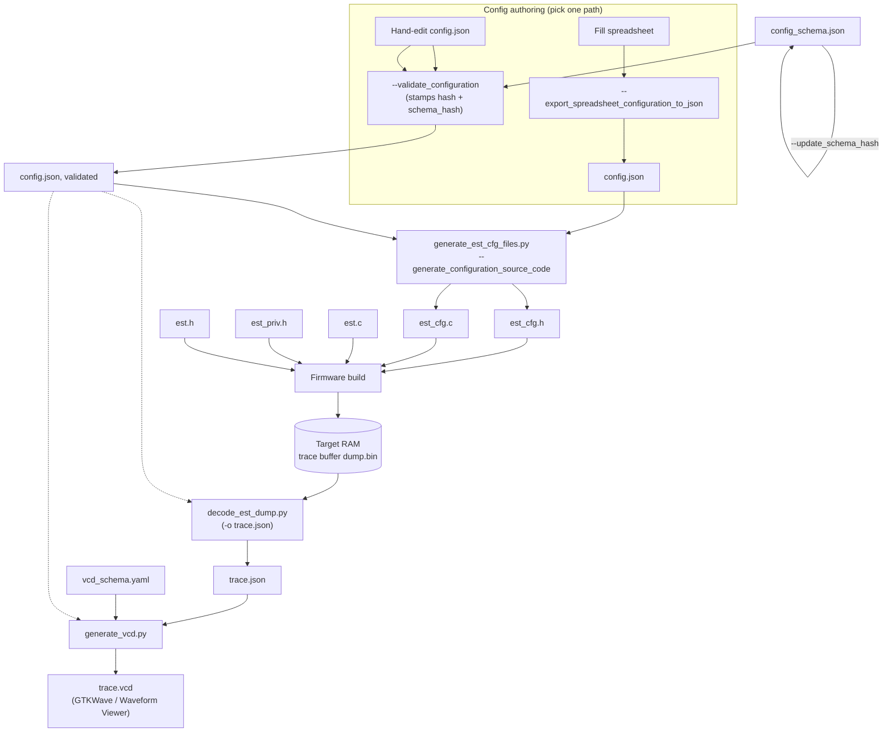

# EST (Embedded Software Tracer) — Project Guide & User Manual

## 1. Overview

**EST** (Embedded Software Tracer) is a lightweight, configurable event-tracing
framework for embedded C firmware. It lets you sprinkle low-overhead **trace
points** through application code; at runtime, each one logs a timestamped,
optionally-typed event into a RAM buffer. Later, host tooling included in this
repository decodes that buffer off the target — over a debug probe or from a
memory dump — and turns it into human-readable data and graphical waveforms:

- `decode_est_dump.py` serves as the reference decoder: given `config.json` and
  a binary dump of the RAM block, it extracts all surviving events with their
  timestamps into human-readable text or structured JSON.
- `generate_vcd.py` transforms the decoded event JSON into standard IEEE 1364
  Value Change Dump (VCD) trace files using rules defined in `vcd_schema.yaml`,
  ready for inspection in waveform viewers like GTKWave, PulseView, or Surfer.

The project has two halves that meet in the middle:

- A **fixed runtime engine** (`est.h`, `est_priv.h`, `est.c`) — the same
  three files for every project, handling buffer writes, timestamp encoding,
  and event serialization. You do not edit these per project.
- A **per-project configuration layer** — a JSON file describing your buffer
  size, timestamp strategy, and the exact list of trace points you want —
  which a code generator turns into two more files (`est_cfg.h`,
  `est_cfg.c`) tailored to that configuration.

A chain of SHA-256 content hashes ties the configuration, its schema, and
the generated code together, so generated code can never silently drift out
of sync with the configuration it claims to represent.

### Quick start

```bash
# 1. (only if you changed config_schema.json itself) re-stamp its hash
python3 manage_est_json_io.py --update_schema_hash config_schema.json

# 2. edit config.json by hand, then validate + hash it
python3 manage_est_json_io.py --validate_configuration config_schema.json config.json

# 3. generate the C sources
python3 generate_est_cfg_files.py --generate_configuration_source_code config.json

# 4. add est.h, est_priv.h, est.c, est_cfg.h, est_cfg.c to your firmware build,
#    call TRC_Init() at startup, and start placing TRC_* macros in your code.

# 5. extract a memory dump from target RAM, then decode to structured JSON:
python3 decode_est_dump.py config.json dump.bin -o trace.json

# 6. generate an IEEE 1364 VCD waveform file from the decoded events:
python3 generate_vcd.py --vcd-schema vcd_schema.yaml --config config.json --trace-json trace.json --output trace.vcd
```

The rest of this document explains each moving part and every step in
detail.

---

## 2. How It Fits Together



Include relationships inside the firmware build:

```
[ Application C Files ]
        │ includes
        ▼
   ┌──────────┐
   │  est.h   │  (public types, mode constants; includes est_cfg.h)
   └────┬─────┘
        │ includes
        ▼
   ┌──────────┐
   │ est_cfg.h│  (generated: per-project macros, TRC_Init/TimerOverflow decls)
   └──────────┘

[ Engine translation units ]
   est_cfg.c ──┐
               ├─ includes → est_priv.h ─ includes → est.h
   est.c ──────┘
```

Application code only ever includes `est.h`. `est_priv.h` is internal —
only `est.c` and `est_cfg.c` include it.

---

## 3. Component Reference

### 3.1 Core engine (static — identical across projects)

| File | Role |
|---|---|
| `est.h` | The public entry point for traced modules. Defines the buffer-type and timestamp-mode constants (`EST_BF_CIRCULAR`, `EST_BF_LINEAR`, `EST_TS_ULEB128`, `EST_TS_FULL_2B/3B/4B`), pulls in the generated `est_cfg.h` (trace macros), and declares `est_log`. Contains no internal layout or RAM block details. |
| `est_priv.h` | Internal-only interface for EST engine and test/dumper harnesses. Defines `est_metadata_t`, `est_ram_block_t` (the full RAM layout: magic sentinels + metadata + buffer + optional alignment padding + trailing magic sentinels), compile-time layout assertions, `extern est_ram_block_t g_est_ram_block;`, and declares internal engine functions (`est_init`, `est_log`, `est_sys_timer_overflow`). |
| `est.c` | The engine implementation. Allocates `g_est_ram_block`, implements `est_init` (initializes magic sentinels and resets metadata fields), `est_write_linear`/`est_write_circular` low-level buffer writers, `est_log`, and `est_sys_timer_overflow`. |

### 3.2 Generated files (per project — do not hand-edit)

| File | Role |
|---|---|
| `est_cfg.h` | Generated from `config.json`. Defines `EST_BUFFER_SIZE`, `EST_BUFFER_ALIGN_BYTES`, `EST_SHORT_CONFIG_HASH`, `EST_TRACE_ID_BYTES`, `EST_BUFFER_TYPE`, `EST_TIMESTAMP_STORAGE`, `EST_TS_STORAGE_BYTES`, `EST_ID_SYNC`; declares `TRC_Init`, the timer-overflow function, the `est_pack_*` argument-marshaling helpers, and `est_log`; and defines one `TRC_<Group><Name><Suffix>(...)` macro per enabled trace-point/suffix combination. |
| `est_cfg.c` | Generated alongside it. Thin, highly configuration-dependent layer containing hash verification (`#error` on hash mismatch), application endpoint forwarders (`TRC_Init` calling `est_init`, overflow API calling `est_sys_timer_overflow`), and the generated `est_pack_*` payload packing implementations. |

Regenerating always fully overwrites both files — never hand-edit them.

### 3.3 Configuration layer

| File | Role |
|---|---|
| `config_schema.json` | A JSON Schema (draft 2020-12) describing what a valid `config.json` looks like: the `General` settings object and the `TracePoints` array. Carries its own `hash`, a SHA-256 of its `properties` sub-object, so a config can pin itself to an exact schema version. |
| `config.json` | Your actual tracer configuration: buffer size/type, timestamp strategy, and the list of trace points. Carries `hash` (a SHA-256 of its own `General`/`TracePoints` content) and `schema_hash` (must match the schema's `hash`). |
| `vcd_schema.yaml` | Declarative YAML specification defining how decoded tracepoint events, payloads, and concurrency/reentrancy policies (FIFO, FILO, counters) map into IEEE 1364 VCD waveform variables. |

### 3.4 Tooling (Python, runs on your dev machine — not part of the firmware build)

| File | Role |
|---|---|
| `generate_est_cfg_files.py` | Verifies `config.json`'s own `hash`, then generates `est_cfg.h`/`est_cfg.c` from it. This is the only step that touches C code generation. |
| `manage_est_json_io.py` | Everything configuration-related: stamping the schema's hash, validating a config against the schema, and converting between JSON and Excel/OpenDocument spreadsheets so non-programmers can fill in a config without touching JSON directly. |
| `decode_est_dump.py` | Reference decoder. Given `config.json` and a binary dump of the `g_est_ram_block` memory, locates the magic sentinels, reads the 8-byte metadata, and decodes every surviving record using only `config.json` for all configuration parameters. Supports both linear and circular (with forward resync) modes and all timestamp storage modes. Exports structured JSON via `-o` / `--output`. |
| `generate_vcd.py` | Policy-driven IEEE 1364 VCD generator. Reads decoded trace JSON, `config.json`, and `vcd_schema.yaml` to synthesize multi/single FIFO/FILO waveforms, counters, and raw/stringified argument variables for visualization in waveform viewers like GTKWave or PulseView. |

### 3.5 Documentation

| File | Role |
|---|---|
| `architecture.txt` | A plain-text include-relationship diagram, mirroring section 2 above. |

---

## 4. Configuration Reference

### 4.1 `General` object

| Field | Type | Meaning |
|---|---|---|
| `TracerPrefix` | string | Prepended to every generated name (`TRC_` → `TRC_Init`, `TRC_EV_Foo`, …). |
| `TracerEnabled` | boolean | Master switch. `false` makes **every** trace macro a no-op, regardless of each point's own `TracePointEnabled`. |
| `TracerBufferSize` | integer ≥ 0 | RAM trace buffer size in bytes. |
| `TracerBufferType` | `"circular"` \| `"linear"` | See §6.1. |
| `TracePointIDSize` | `"1B"` \| `"2B"` \| `"3B"` \| `"4B"` | Width of each trace point's numeric ID on the wire. |
| `TracePointNameUnique` | boolean | If `true`, each `TracePointName` must be strictly unique across all trace points, regardless of group or subtype. If `false`, only the full macro name (`TracePointGroup + TracePointName + subtype`) must be unique. (When group and subtype are absent, this inherently enforces name uniqueness). |
| `TracePointNameUnderscored` | boolean | If `true`, all trace point macro elements (prefix, group, name, type, subtype) and generated functions (e.g. Init) are separated by an underscore (`<prefix>_<group>_<name>_<type>_<subtype>`, `<prefix>_Init`). If `false` (default), elements are concatenated directly (`<prefix><group><name><type><subtype>`, `<prefix>Init`). |
| `TimestampResolutionValue`, `TimestampResolutionUnit` | integer, `"ns"`\|`"us"`\|`"ms"`\|`"s"` | What one timestamp tick represents in real time (e.g. `1` + `"us"`). **Not used by the C generator** — captured here for the downstream decoder, which needs it to convert raw ticks into real time when writing a trace file. `est_log`'s own tick parameter is named `now_ticks`, not `now_us` or similar, precisely because the engine treats it as an opaque counter regardless of which unit your config declares — it only ever subtracts or byte-splits the value, never interprets it. |
| `TimestampCntSize` | `"2B"` \| `"3B"` \| `"4B"` | Hardware timer counter width. Defines the hardware overflow value (`0xFFFF` for 2B, `0xFFFFFF` for 3B, `0xFFFFFFFF` for 4B) used by both the generator and decoder regardless of storage format. |
| `TimestampStorage` | `"fixed"` \| `"ULEB128"` | How timestamps are serialized in the buffer. `"fixed"` stores `TimestampCntSize` bytes; `"ULEB128"` stores ULEB128 deltas. See §6.2. |
| `TimestampAPI` | string | How to read the current timestamp, e.g. `"GetTimestamp(&timestamp);"`. Three forms are recognized: a reference-style call (`Func(&x)`), an assignment (`x = Func()`), or a bare expression. |
| `TimestampOverflowAPI` | string | Name for the generated wrapper (e.g. `"TimerOverflow();"` → a function literally named `TimerOverflow`) that you call from your real hardware-timer overflow handler. |
| `TimestampHeader` | string | Header `#include`d by `est_cfg.h` that declares whatever `TimestampAPI` calls. |
| `AtomicSectionStartAPI`, `AtomicSectionStopAPI` | string | **Optional**. Statements wrapping enabled trace macro bodies to make logging atomic (e.g. disable/enable interrupts). Required only if at least one trace point sets `AtomicSectionRequired: true`. |
| `AtomicSectionHeader` | string | **Optional**. Header `#include`d by `est_cfg.h` that declares the atomic-section functions. Required only if at least one trace point sets `AtomicSectionRequired: true`. |

### 4.2 `TracePoints[]` item

| Field | Type | Required | Meaning |
|---|---|---|---|
| `TracePointGroup` | string | no | Short prefix for related points, e.g. `"EV_"`. Defaults to empty. |
| `TracePointName` | string | yes | Identifier, e.g. `"Tracepoint0"`. |
| `TracePointIDs` | object, see §4.6 | yes | One hex ID per macro suffix this point generates, keyed by suffix name. Computed automatically — see §4.6. |
| `TracePointEnabled` | boolean | yes | `false` compiles the macro(s) to a no-op — but the ID is still reserved (see §4.6), so re-enabling it later won't collide with anything allocated in the meantime. |
| `TracePointType` | see §4.3 | no | Optional. Determines which macro suffix(es) get generated. If omitted or blank, generates a single macro with no suffix. |
| `TracePointInstanceSize` | string (`"1B"` or `"2B"`), see §4.4 | no | Distinguishes between multiple object instances sharing common trace points. If `"1B"` (`uint8_t`, 0–255) or `"2B"` (`uint16_t`, 0–65535), the macro takes instance `i` as its first parameter before any data fields. If omitted, the trace point has no instances. |
| `TracePointData` | array of type tokens, see §4.5 | no | Arguments the macro takes and packs into the payload. Omit or use `[]` for an event with no data. |
| `AtomicSectionRequired` | boolean | yes | If `true`, the macro wraps the logging call in atomic section start/stop functions (and requires the 3 General atomic parameters to be configured). If `false`, no atomic section calls are generated for this trace point. |

### 4.3 Trace point type → macro suffixes

`TracePointType` is **optional** and **fully dynamic**. The complete mapping of type names to their subtypes (suffixes) lives in `config_schema.json` under `TracePointSubtype["const"]` inside `properties`. All Python scripts (validation, spreadsheet generation, ID generation, C code generation) load this mapping at runtime — no type name or subtype is hardcoded anywhere.

**Rules:**
- If `TracePointType` is **omitted or blank**, a single macro with no suffix is generated. The `TracePointIDs` object must contain exactly one entry with an empty string key `""`.
- If `TracePointType` is present, the scripts look up its subtypes from `TracePointSubtype["const"]` in the schema. `TracePointIDs` must contain exactly one entry per subtype, keyed by the subtype name.
- To add a new type or change subtypes for an existing type, **only** edit `config_schema.json` (`TracePointSubtype["const"]`) and update the schema hash. No Python script changes are needed.

**Currently defined in `TracePointSubtype["const"]`:**

| `TracePointType` | Suffixes generated | Example (`Group="EV_"`, `Name="Foo"`) |
|---|---|---|
| *(blank / omitted)* | *(none)* | `TRC_EV_Foo(...)` |
| `signal` | `Send`, `Receive` | `TRC_EV_FooSend(...)`, `TRC_EV_FooReceive(...)` |
| `task` | `Start`, `Activate`, `Preempt`, `Terminate`, `Wait`, `Release` | `TRC_EV_FooStart()`, … |
| `isr` | `Begin`, `End` | `TRC_EV_FooBegin()`, `TRC_EV_FooEnd()` |
| `routine` | `Begin`, `End` | `TRC_EV_FooBegin(...)`, `TRC_EV_FooEnd(...)` |
| `hsm` | `Init`, `Entry`, `Exit`, `Event`, `Timer`, `Transition` | `TRC_EV_FooInit(...)`, `TRC_EV_FooEntry(...)`, … |

### 4.4 Trace point instances (`TracePointInstanceSize`)

Instances are used when multiple objects or threads share common trace points (for example, multiple active objects sharing the same state machine implementation). Since they share code, they execute the same tracepoint with the same ID; the instance parameter allows the decoder and trace analysis tools to distinguish which object instance emitted the event.

- **`"1B"`**: 1-byte instance identifier (`uint8_t`), range `0`–`255`.
- **`"2B"`**: 2-byte instance identifier (`uint16_t`), range `0`–`65535`.
- **Omitted**: Trace point does not have instances (the cell can be left empty in the spreadsheet).

When an instance size is specified:
1. In the trace point C macro, the instance is passed as the **first macro parameter**, always named `i`. User payload arguments (if any) follow after:
   - Event with instance only: `TRC_EV_Tracepoint5(i)`
   - Signal with instance and data: `TRC_SIG_Tracepoint6Send(i, d1, d2, d3)`
2. The instance integer is serialized into the trace buffer as the first 1 or 2 bytes before any user payload fields.
3. The decoder (`decode_est_dump.py`) extracts this instance, includes `"Instance": <val>` in the structured trace JSON, and displays `inst=<val>` in summary output.

### 4.5 `TracePointData` type tokens

Three kinds of token are accepted: 10 fixed-width types, bitfields, and arrays.

**Fixed-width types:**

| Category | Accepted token | C type | Size |
|---|---|---|---|
| unsigned 8-bit | `u8` | `uint8_t` | 1 |
| signed 8-bit | `s8` | `int8_t` | 1 |
| unsigned 16-bit | `u16` | `uint16_t` | 2 |
| signed 16-bit | `s16` | `int16_t` | 2 |
| unsigned 32-bit | `u32` | `uint32_t` | 4 |
| signed 32-bit | `s32` | `int32_t` | 4 |
| unsigned 64-bit | `u64` | `uint64_t` | 8 |
| signed 64-bit | `s64` | `int64_t` | 8 |
| float | `f32` | `float` | 4 |
| double | `f64` | `double` | 8 |

This 10-item list is deliberately closed (a JSON Schema `enum`, not a
free-form pattern) — a typo is rejected at validation time with a clear
message instead of surfacing later as a generator crash or a silently-wrong
payload size. There's no plan to accept alternate spellings (`uint8_t`,
`float`, etc.) for these 10.

**Arrays:** a token `<base>a<size>` declares a fixed-length array of `<size>` elements of base type `<base>`.
- **Allowed base types:** only `'u'`, `'s'`, and `'f'` primitive types can be stored as arrays (`u8`, `s8`, `u16`, `s16`, `u32`, `s32`, `u64`, `s64`, `f32`, `f64`). Examples: `u8a5` (array of 5 `uint8_t`), `f32a3` (array of 3 `float`), `s16a10` (array of 10 `int16_t`).
- **Bitfields cannot be stored as arrays:** bitfield tokens such as `b4a2` are strictly disallowed.
- **Array size syntax:** `<size>` must be a positive non-zero integer without leading zeros (e.g. `u8a5`). Invalid array formats (no size e.g. `u8a`, zero size e.g. `u8a0`, non-number size e.g. `u8aa`, leading zeros e.g. `u8a05`) are validated and rejected during spreadsheet export (`manage_est_json_io.py`) and config validation, aborting with a clear error so that `config.json` only ever contains valid data.
- **C Macro usage:** When an array is configured, the trace point macro takes a **pointer** to the array as an argument (the user provides the array name or the address of its first element, e.g. `TRC_EV_Tracepoint0(my_arr)` or `TRC_EV_Tracepoint0(&my_arr[0])`).
- **No manual size argument:** The size of the array (`sizeof(<type>) * <count>`) is generated automatically within the tracepoint macro / helper context for `memcpy`. The user does not provide the array size as a macro argument because it is already known from the configuration.
- **Storage & Payload:** Array elements are copied sequentially into the payload buffer occupying `sizeof(base_type) * count` bytes. Like ordinary types, an array token breaks any consecutive bitfield run.
- **Decoder:** The decoder (`decode_est_dump.py`) reconstructs array elements into a list under `"Value"` (e.g. `{"Type": "u8a5", "Value": [1, 2, 3, 4, 5]}`) and prints them as `u8a5=[1, 2, 3, 4, 5]`.

**Bitfields:** a token `bN`, where `N` is `1`–`64` (e.g. `b1`, `b13`, `b64`),
declares an `N`-bit unsigned value. Unlike the fixed-width types, bitfields
don't get their own byte(s) each — consecutive bitfield tokens are packed
together into as few whole bytes as possible, and a non-bitfield token
always ends the current run (so `["u8","b3","b5"]` packs `b3` and `b5`
together, but `["b3","u8","b5"]` gives `b3` and `b5` each their own byte,
since the `u8` between them breaks the run).

**Packing rule:** within a run, fields are concatenated LSB-first — the
first field occupies the low bits, each later field is shifted up by the
sum of the widths before it, and any leftover bits sit unused at the *top*
of the container. A run keeps growing into the same word as long as it fits
in 64 bits; once total bits exceed 64, that field starts a new word. Each
closed word picks the smallest container(s) that hold it exactly: if the
bit count doesn't fill a single `u8`/`u16`/`u32`/`u64` cleanly, it splits
into the binary decomposition of the byte count instead of wasting a full
spare byte — e.g. 24 bits splits as `u16+u8` (zero waste) rather than a
`u32` that wastes 8 bits. This packing is a pure value-level computation
(`<<`/`&`/`|`), so it's independent of target endianness; only the final
byte-order of each finished word going into the trace buffer depends on
that, exactly as it already does for every other multi-byte type here.

Worked example — `["b1","b2","b3","b4","b5","b1","b13"]` (29 bits total,
fits one `u32`, 3 bits unused at the top):

| field | width | bits |
|---|---|---|
| 1st | 1 | [0,0] |
| 2nd | 2 | [1,2] |
| 3rd | 3 | [3,5] |
| 4th | 4 | [6,9] |
| 5th | 5 | [10,14] |
| 6th | 1 | [15,15] |
| 7th | 13 | [16,28] |
| — | 3 | [29,31] unused |

Worked example — `["b1","b2","u8","b3","b4","f32","b5","b1","s8","b13"]`:
four separate runs, broken by the ordinary types between them — `b1,b2`
share a `u8` (5 bits unused), `b3,b4` share a `u8` (1 bit unused), `b5,b1`
share a `u8` (2 bits unused), and the lone `b13` gets its own `u16` (3 bits
unused) — 7 payload chunks in total, each ordinary type still packed exactly
as before.

**A single bitfield can span more than one physical container.** If the
byte-decomposition split for a word would cut through the middle of a field,
that field is packed into two (or, for a wide field in a heavily-split word,
even three) separate storage variables: each container gets the slice of
the field's bits that falls within it, extracted by shifting the field's own
value down to that slice before masking. Nothing is lost or duplicated —
every bit of every field lands in exactly one place. For example,
`["b5","b12","b3"]` (20 bits, splitting as `u16+u8`) packs `b5` and the low
11 bits of `b12` into the `u16` (filling it exactly, zero waste), then the
top bit of `b12` and all of `b3` into the `u8` (4 of its 8 bits used).

**Hard limit:** the combined size of one trace point's packed
`TracePointData` — fixed-width types at their own size, arrays at their
element size multiplied by element count, bitfield runs at
their packed container size — must not exceed **65535 bytes**, since `est_log`'s
`payload_len` parameter is `uint16_t`. The generator rejects anything over
that at generation time. In practice, buffer sizes are far smaller — this
limit exists to avoid silent truncation, not to encourage large payloads.

In a spreadsheet cell, enter multiple tokens as one string separated by
spaces, commas, or semicolons, e.g. `u32, f32, u8a5, b3, b5`.

### 4.6 Trace point IDs (`TracePointIDs`)

Each macro needs a stable numeric ID on the wire. These are **computed once,
by `manage_est_json_io.py`, and stored in `config.json`** as `TracePointIDs`
— `generate_est_cfg_files.py` only ever reads and validates them; it never
calculates a single one.

**Shape.** `TracePointIDs` is an object keyed by macro suffix, one entry per
suffix the point's `TracePointType` generates (§4.3):

```json
{
  "TracePointGroup": "SIG_",
  "TracePointName": "Foo",
  "TracePointIDs": { "Send": "0x7B2F", "Receive": "0xB238" },
  "TracePointType": "signal",
  ...
}
```

Types with no suffix (`event`) use a single empty-string key:
`"TracePointIDs": { "": "0x770D" }`. Each value is a hex string, `0x`
followed by uppercase `A`–`F`/`0`–`9` digits (`^0x[0-9A-F]+$` in the schema —
deliberately open-ended on length, since the digit count that actually
matters, `TracePointIDSize × 2`, is a per-project setting, not a schema-wide
constant). `manage_est_json_io.py` always writes them zero-padded to that
width.

**Where they come from.** Each value is `SHA-256(TracePointGroup +
TracePointName + suffix)`, folded down to `TracePointIDSize` bytes by
XOR-ing successive chunks of the digest — deterministic, so re-exporting an
unchanged trace point from a spreadsheet always reproduces the exact same
ID. IDs are minted for **every** point/suffix combination, enabled or not:

- Disabled points still reserve their ID — enabling them later can't
  collide with something allocated in between.
- If two combinations ever hash to the same ID, or one collides with the
  reserved sync ID (all-ones for the configured ID width, e.g. `0xFFFF` for
  2-byte IDs), `manage_est_json_io.py` stops with a `FATAL ERROR` naming
  both offending macros at export time — you'd rename one of them and
  re-export. `generate_est_cfg_files.py` re-runs the same two checks (plus
  hex format and bit-width) against whatever `TracePointIDs` it's handed, as
  a second line of defense against a hand-edited or otherwise-corrupted
  config.

**Never in the spreadsheet.** There's no `TracePointIDs` column — nothing
about it is meaningful for a person to type in, since it's a pure function
of data that's already there (group, name, suffix) plus a config-wide
setting (`TracePointIDSize`). `--export_spreadsheet_configuration_to_json`
computes it fresh on every export.

**Hand-editing `config.json` directly (Path A, §7.3):** fine for edits that
don't touch a point's group, name, or type — `TracePointIDs` stays exactly
as it is. Adding a trace point, or renaming/retyping an existing one, means
its `TracePointIDs` needs to change too, which in practice means computing a
SHA-256 by hand — not realistic. For that kind of edit, go through Path B
(spreadsheet) instead, even for a single trace point: import the current
config to a spreadsheet, make the change, export back to JSON, and the
right `TracePointIDs` come out the other end automatically.

### 4.7 Trace point data overrides (`TracePointDataOverrides`)

In the `TracePoints` sheet or container, data arguments (`TracePointData`) are defined at the trace point level, meaning all subtypes of a typed trace point (e.g. `Send` and `Receive` for a `signal`, or `Begin` and `End` for a `routine`) share the exact same arguments by default.

When different subtypes require different data arguments (e.g. `Send` logs a `u32` transaction ID while `Receive` logs two `u8` status bytes), you do not configure separate trace points in `TracePoints`. Instead, you override their data arguments using the **`TracePointDataOverrides`** worksheet or JSON array.

> [!IMPORTANT]
> **Override-only semantics:** `TracePointDataOverrides` solely overrides data arguments for trace points that have already been declared in `TracePoints`. It never creates or declares new trace points. If a trace point originally has no arguments (`[]`), assigning data arguments to it in `TracePointDataOverrides` is still strictly treated as an override of its data payload.

#### Worksheet Structure & Columns

The `TracePointDataOverrides` worksheet consists of 6 consecutive columns:

1. **`TracePointFilterKind`** — Filter matching mode: `"wildcards"` or `"regex"`. (In Excel, this column features a dropdown list).
2. **`TracePointGroupFilter`** — Matches `TracePointGroup`.
3. **`TracePointNameFilter`** — Matches `TracePointName`.
4. **`TracePointTypeFilter`** — Matches `TracePointType` (or empty string for untyped trace points).
5. **`TracePointSubtypeFilter`** — Matches the specific subtype suffix (e.g. `Send`, `Receive`, `Begin`, `End`, or empty string for untyped trace points).
6. **`TracePointDataOverride`** — The replacement data arguments (e.g. `u32`, `u8, u8`, `u8a5`). If left blank or empty, the matching trace point's arguments are overridden to empty (`[]`).

#### Matching Modes

- **`wildcards`**:
  - `*` matches zero or more characters.
  - `?` matches exactly one character.
  - All other characters match literally.
- **`regex`**:
  - Full regular expression pattern matching (via `re.fullmatch`).

#### Validation & Conflict Rules

To guarantee predictable code generation and avoid ambiguous configuration:

1. **One-to-Many Override Matching:**
   - Override entries are filters that can match **zero, one, or multiple** configured trace point endpoints. For example, a wildcard filter `* * * Init` can clear or set the data for all trace points having subtype `Init`.
2. **Conflict Prevention:**
   - If two or more override rows match the same trace point endpoint, but all matching rows specify the **exact same** `TracePointDataOverride` data arguments, this is allowed without conflict.
   - If two or more override rows match the same trace point endpoint and specify **differing** override data, export or validation is aborted with an ambiguity error:
     `SPREADSHEET VALIDATION ERROR: Conflicting data overrides for trace point '...' (type '...', subtype '...'): row N specifies '...' but earlier row M specified '...'!`
3. **Unmatched trace points retain their base `TracePointData`** as defined in `TracePoints`.

#### JSON Configuration Storage

In `config.json`, the top-level `TracePointDataOverrides` section is persisted exactly as loaded from the spreadsheet.

In addition, each trace point's `TracePointData` in `TracePoints` reflects the effective overridden arguments:
- If all subtypes share identical data (or for untyped trace points):
  ```json
  "TracePointData": ["u8"]
  ```
- If subtypes have different data arguments:
  ```json
  "TracePointData": {
    "Send": ["u32"],
    "Receive": ["u8", "u8"]
  }
  ```

### 4.8 Trace point data stringification (`TracePointDataStringify`)

To turn raw numeric trace point values into human-readable descriptions directly during trace decoding (such as mapping state codes `0..9` to `INIT_%d`, temperatures to `T_%.1f`, or byte arrays to formatted hex strings), EST provides the **`TracePointDataStringify`** configuration section and spreadsheet worksheet.

This feature operates purely as **decode-time metadata**:
- Embedded C macros and runtime logging remain lean, numeric, and deterministic (no string operations or formatting overhead in firmware).
- The Python decoder (`decode_est_dump.py`) parses the logged binary values and uses the stringify definitions to attach a formatted `"Stringify"` field to each matching data argument in the output JSON.
- The downstream VCD generator (`generate_vcd.py`) automatically maps stringified fields to IEEE 1364 `string` variables in the waveform trace.

#### Text-Only Spreadsheet Cell Formatting

All worksheets in generated spreadsheets (`.xlsx` and `.ods`) enforce **text-only cell representation**:
- In `.xlsx`, column-level number format is set to `@` (`number_format = '@'`) across all columns in all worksheets, and cell values are emitted strictly as text strings.
- This prevents spreadsheet applications (such as Microsoft Excel or LibreOffice Calc) from corrupting user input — ensuring range operators (e.g. `20..`, `..`), hex constants (`0xFF`), bitfield indicators (`b1`–`b64`), and decimal dot numbers (`3.5`, `1.2e-4`) are never auto-converted to dates, formulas, or localized decimal numbers.

#### Worksheet Structure & Columns

The `TracePointDataStringify` worksheet is positioned directly below `TracePointDataOverrides` and consists of 3 columns:

1. **`Name`** — The stringify rule identifier.
   - Accepts letters, digits, and underscores (`[A-Za-z0-9_]+`).
   - The same `Name` can appear across multiple rows to define separate value ranges or formatting rules under that name.
   - **Scalar format:** plain identifier, e.g. `state_str`.
   - **Array format:** identifier with an array index range in square brackets, e.g. `arr_str[..]`, `arr_str[3]`, `arr_str[..5]`, `arr_str[3..7]`, `arr_str[3..]`.
   > [!IMPORTANT]
   > Square brackets appear **only in the definition** (`Name` column of `TracePointDataStringify`). When applying the rule to a trace point token in `TracePointData`, square brackets are **never** used.

2. **`Values`** — The numeric condition or value range that triggers this stringify rule.
   - Numbers may be written in decimal, hexadecimal (`0x`/`0X`), floating-point (period decimal separator only; comma is rejected), or scientific E-notation (e.g. `-3`, `0`, `22`, `3.5`, `3.345e15`, `2.234E-4`, `0xFF`).
   - **Range operators (`..`)**:
     - `..` — matches all values ($-\infty$ to $+\infty$).
     - `A..` — matches all values greater than or equal to $A$ ($[A, +\infty)$).
     - `..B` — matches all values less than or equal to $B$ ($(-\infty, B]$).
     - `A..B` — matches values between $A$ and $B$ inclusive ($[A, B]$); requires $A \le B$.
     - `A` — matches the single value $A$ ($[A, A]$).
   - **Overlap detection:** For any given `Name` (and index range for array rules), all defined value ranges must be mutually disjoint. Overlapping ranges (e.g. `0..7` and `7..15`, or `..10` and `5..`) are rejected with a validation error during spreadsheet export or config validation.

3. **`Stringify`** — A `printf`-style format template.
   - Supported conversion specifiers: `%d`, `%i`, `%f`, `%e`, `%E`, `%g`, `%G`, `%u`, `%x`, `%X`, `%o`, and `%%` (literal percent).
   - **`%i` specifier:** Evaluates to the 0-based decimal index of an array element. (Only applicable to array data elements).
   - Value specifiers (such as `%d`, `%x`, `%f`) format the element's unpacked numeric value.
   - At most **one** value conversion specifier is allowed per format string.
   - The `%s` specifier is explicitly disallowed (stringify operates on numeric values, not nested strings).

#### Applying Stringify to Trace Points

Stringify rules are attached to data tokens in `TracePointData` (in the `TracePoints` sheet) or `TracePointDataOverride` (in the `TracePointDataOverrides` sheet) by appending `(<Name>)` to the token type:

- **Scalar tokens:**
  - `u8(state_str)` — applies scalar rule `state_str` to a single `u8`.
  - `f32(temp_str)` — applies scalar rule `temp_str` to a single `f32`.
  - `b4(mode_str)` — applies scalar rule `mode_str` to a 4-bit bitfield.
- **Array tokens:**
  - `u16a5(arr_str)` — applies indexed rule `arr_str` to a 5-element `u16` array (syntax uses plain name without brackets).
- **Untraced/unstringified tokens:**
  - `u8`, `u32`, `b8`, `u8a3` — standard tokens without `(<Name>)` suffix remain unstringified.

#### Compatibility & Warning Rules

1. If an indexed stringify definition (e.g. `arr_str[..]`) is referenced on a **scalar** token (e.g. `u16(arr_str)`), the validator emits a warning and the stringify rule is ignored.
2. If a non-indexed stringify definition (e.g. `state_str`) is referenced on an **array** token (e.g. `u16a5(state_str)`), the validator emits a warning and the stringify rule is ignored.
3. Referencing an undefined stringify name causes validation to abort with an error.

#### Decoded Output JSON Format

When `decode_est_dump.py` decodes a memory dump:
- For a scalar data element with a matching stringify range:
  ```json
  {
    "Type": "u32",
    "Value": 15,
    "Stringify": "RUN_15"
  }
  ```
- If a scalar value does not match any configured range, the `"Stringify"` key is omitted:
  ```json
  {
    "Type": "u32",
    "Value": 9999
  }
  ```
- For an array data element:
  ```json
  {
    "Type": "u8a3",
    "Value": [10, 20, 30],
    "Stringify": ["ELEM_0_0x0A", "ELEM_1_0x14", "ELEM_2_0x1E"]
  }
  ```
- If individual array elements do not match any defined range, their entry in `"Stringify"` is `null`. If no elements in the array match any rule, the entire `"Stringify"` key is omitted.

### 4.9 VCD Waveform Schema (`vcd_schema.yaml`)

`vcd_schema.yaml` configures how decoded events and payloads map to IEEE 1364 VCD waveforms generated by `generate_vcd.py`. The schema is organized into two primary layers under the root `tracepoints` key:

#### 1. `basic_layer` (Universal Trace Points & Arguments)

The basic layer defines universal event indicators and payload variable representations:

- **`primary`**: Represents the occurrence of any trace point event.
  - `identifier`: Name template for the VCD variable (e.g. `"${full_name}"`).
  - `var_type`: Verilog variable type (e.g. `event`, `wire 1`).
  - `on_init`: Initial value at time 0 (or `null` to omit initialization).
  - `on_occurrence`: Value emitted whenever the event fires (e.g. `1`).
- **`arguments`**: Maps payload data fields to VCD variables, partitioned into `scalar` and `array` handlers:
  - `raw`: Numeric or unpacked payload value (e.g. `var_type: "real 32"`, identifier `"${full_name}_arg_${arg_idx}"` or `"${full_name}_arg_${arg_idx}_a${array_idx}"`).
  - `stringified`: Text string generated by `TracePointDataStringify` (e.g. `var_type: string`, identifier `"${full_name}_arg_${arg_idx}_str"` or `"${full_name}_arg_${arg_idx}_a${array_idx}_str"`).

#### 2. `derived_layer` (Policy-Driven State Waveforms)

The derived layer maps trace point types (e.g. `signal`, `routine`, `task`, `isr`) to high-level concurrency and reentrancy behaviors using **5 execution policies**:

| Policy | Behavior | Common Use Case |
|---|---|---|
| `multi_trace_fifo` | Dynamic multi-slot allocation (`slot_1`, `slot_2`, ...). Each activation claims the lowest available slot; deactivation releases the **oldest** active slot. | Asynchronous signal queues, message pipelines. |
| `single_trace_fifo` | Single-slot representation (`slot_1`). Turns active on the first activation; turns idle on the first deactivation. | Simple activity/busy status. |
| `multi_trace_filo` | Dynamic stack-allocated slots (`slot_1`, `slot_2`, ...). Each activation pushes a new slot; deactivation pops the **newest/top** slot. | Nested function calls, reentrant routines, interrupt nesting. |
| `single_trace_filo` | Single-slot reference-counted representation. Activates on the first entry; remains active until the **last** matching exit returns the count to zero. | Aggregate module activity, shared resource lock. |
| `counter` | Tracks integer or real numerical depth. Increments on `increase_on`/`activate_on` and decrements on `decrease_on`/`deactivate_on`. | Pending queue depth, call stack depth, active instance count. |

#### Template Placeholders

Identifiers and labels in `vcd_schema.yaml` accept dynamic template strings:

| Placeholder | Meaning | Example |
|---|---|---|
| `${full_name}` | Full macro name with subtype | `TRC_SIG_Tracepoint1_Send` |
| `${base_name}` | Base trace point name without subtype | `TRC_SIG_Tracepoint1` |
| `${prefix}` | Tracer prefix | `TRC_` |
| `${group}` | Trace point group | `SIG_` |
| `${name}` | Trace point base name | `Tracepoint1` |
| `${type}` | Trace point type | `signal` |
| `${subtype}` | Subtype suffix | `Send` |
| `${slot_idx}` | Slot number for multi-trace policies | `1`, `2`, `3` |
| `${arg_idx}` | 1-based payload argument index | `1`, `2` |
| `${array_idx}` | 0-based array element index | `0`, `1` |
| `${arg_val}` | Raw payload argument value | `42`, `3.14159` |
| `${stringify_str}` | Stringified description | `"INIT_OK"` |

#### Verilog Variable Types & Value Formatting

`generate_vcd.py` supports all 17 IEEE 1364 Verilog types (`event`, `string`, `integer`, `parameter`, `time`, `real`, `realtime`, `wire`, `reg`, `supply0`, `supply1`, `tri`, `trireg`, `tri0`, `tri1`, `wand`, `wor`, `triand`, `trior`):
- Explicit bit-widths (e.g. `wire 1`, `reg 32`, `reg [127:0]`) are clamped to the valid VCD scope `[1, 65536]`.
- Counter policies require displayable/numerical types (`real`, `realtime`, `integer`, `string`; defaults to `real 64`).
- Values support standard 4-state and multi-state logic: `0`, `1`, `x`, `X`, `z`, `Z`, `h`, `H`, `l`, `L`, `u`, `U`, `w`, `W`, `-`.

---

## 5. The Integrity Chain

Four hashes keep the schema, config, and generated code from silently
drifting apart:

1. **Schema hash** — `config_schema.json`'s `hash` is a SHA-256 of its own
`properties` object (not the whole document — top-level keys like
`title` aren't hashed). `--update_schema_hash` recomputes and stores it;
run this any time you change what a valid config looks like.
2. **Config hash** — `config.json`'s `hash` is a SHA-256 of its own
`General`/`TracePoints` content (excluding `hash`, `schema_hash`, and
`short_hash` themselves). `config.json`'s `schema_hash` must equal the
schema's `hash`. `--validate_configuration` is the only step that runs
full JSON Schema validation; on success it (re)stamps `hash`,
`schema_hash`, and `short_hash` in place.
3. **Short hash** — `config.json`'s own `short_hash` field is the config
hash folded down to 32 bits (XOR of successive 4-byte chunks of `hash`),
stored as an `0x`-prefixed hex string, e.g. `"0xA97E0E9A"`. Computed and
stamped by `--validate_configuration` and by
`--export_spreadsheet_configuration_to_json`; re-verified (never
recomputed for use) by `--import_configuration_to_xlsx_spreadsheet` /
`-ictos`, and by `generate_est_cfg_files.py` before it will generate
anything. It's a persisted field rather than something each tool derives
on the fly precisely so every consumer checks the same stored value
instead of quietly trusting its own recomputation.
4. **Generated-code hash** — `short_hash` is baked into `est_cfg.h` as
`EST_SHORT_CONFIG_HASH` (named for what it is: a 32-bit fold, not the
real 256-bit hash). `est_cfg.h` and `est_cfg.c` separately cross-check
this value against each other at compile time
(`#if _EST_CFG_H_ != _EST_CFG_C_`), so a stray regeneration of only one of
the pair fails the build instead of silently shipping mismatched files —
`_EST_CFG_H_`/`_EST_CFG_C_` are deliberately two independent literals
baked in at generation time, not references to `EST_SHORT_CONFIG_HASH`,
since a reference would just inherit whatever `est_cfg.h` happens to be
on disk at compile time and silently defeat this exact check.

`generate_est_cfg_files.py` re-checks both `hash` and `short_hash` (not
the schema directly) before generating code — it trusts that a config
carrying correct, self-consistent hashes already passed
`--validate_configuration`. Any edit that doesn't go through that step (or
the spreadsheet export path, which validates and stamps all three hash
fields itself) will produce a hash mismatch and generation will refuse to
proceed.

`TracePointIDs` (§4.6) is ordinary config content, so tampering with an ID
after the fact is caught the same way as tampering with anything else — a
hash mismatch. `generate_est_cfg_files.py` goes one step further for this
specific field and independently re-checks format, bit-width, and collisions
against what it's handed, rather than relying purely on the hash chain —
one of two fields in the config it doesn't fully trust even when `hash`
matches (the other being `short_hash` itself, which it always
re-derives-and-compares rather than reading blind).

---

## 6. Runtime Model

### 6.1 Buffer types

- **`linear`** — fills once, start to end. When a record does not fit in the
  remaining space, `is_stopped` is set to `1` **and all subsequent records
  are permanently discarded** — including smaller ones that would physically
  fit. This strict halt preserves causal ordering: a decoder reading the
  buffer sees exactly the prefix of events that were logged before the first
  overflow, with no gap or reordering.
- **`circular`** — always accepts new data, wrapping around and overwriting
  the oldest bytes once full. `is_wrapped` is set to `1` on the first wrap.
  A single write larger than the whole buffer is trimmed to just its final
  `buffer_size` bytes — exactly what would survive byte-by-byte — rather
  than being rejected or corrupting the ring.

Both modes are implemented in `est.c`. Pick `linear` when you want "capture
from a cold start until the buffer fills, then stop" (good for a crash or a
one-shot sequence); pick `circular` for "always show me what just happened"
(good for a continuously-running system where you'll pull the buffer on
demand).

### 6.2 Timestamp storage

- **`TimestampCntSize` (`"2B"`, `"3B"`, `"4B"`)** — declares the hardware timer
  counter width. This establishes the exact counter overflow value (`0xFFFF` for 2B,
  `0xFFFFFF` for 3B, `0xFFFFFFFF` for 4B) and counter range (`2^16`, `2^24`, `2^32`)
  for both runtime delta wrapping and downstream epoch reconstruction.
- **`TimestampStorage` (`"ULEB128"`, `"fixed"`)**:
  - **`ULEB128`** — each event stores only the *difference* from the
    previous event's timestamp, using a variable-length unsigned LEB128
    encoding: 7 bits of value per byte, with the top bit marking "another byte
    follows." Deltas are masked to `TimestampCntSize` (`EST_TS_CNT_MASK`),
    efficiently encoding wraps without huge numbers.
  - **`fixed`** — each event stores its absolute timestamp truncated to
    the width declared in `TimestampCntSize` (2, 3, or 4 bytes, least-significant byte
    first). Simpler to decode, at a fixed per-event cost.

All encodings — IDs, fixed-width timestamps, and the ULEB128 varint —
use the same least-significant-byte-first convention, so a decoder only
needs one byte-order rule.

**Coupling with buffer type:**
- When `TracerBufferType` is `"circular"`, `TimestampStorage` **must** be `"fixed"`.
  Dynamic differential timestamps (`"ULEB128"`) are forbidden in circular mode
  because overwriting older records in the ring destroys the relative reference time for surviving events.
- When `TimestampStorage` is `"ULEB128"`, `TracerBufferType` **must** be `"linear"`.
- In `"linear"` mode, both timestamp storage strategies (`"fixed"`, `"ULEB128"`) are permitted.

This constraint is enforced directly by `config_schema.json` via schema `allOf`/`if`/`then` rules, checked automatically during validation and spreadsheet export.

On a hardware timer overflow, call the generated overflow function (named by
`TimestampOverflowAPI`); it logs a sync record using the reserved ID
(`EST_ID_SYNC`) with a timestamp of `0`, which — for `ULEB128` — also
resets the internal "last timestamp" reference point.

### 6.3 The RAM block and metadata

`est_cfg.c` defines `est_ram_block_t`, a naturally 4-byte-aligned struct
(no `packed` attribute) holding everything a decoder needs:

```
magic_start (4B) | magic_start_inv (4B) | est_metadata_t (8B) | buffer[N] | [align_pad] | magic_end_inv (4B) | magic_end (4B)
```

- **Magic sentinels** — `magic_start`/`magic_end` are both
  `EST_SHORT_CONFIG_HASH`; `magic_start_inv`/`magic_end_inv` are its bitwise
  complement. A tool without debug symbols can scan raw RAM for that word
  immediately followed by its complement, which cuts false-positive matches
  far below what scanning for a single 4-byte pattern would give. Tying the
  magic to the config hash means a scanner match doubles as version
  verification — it can only find a block for the exact config/firmware build
  it already knows the short hash for.
- **`est_metadata_t`** — an 8-byte, naturally aligned struct:

  ```c
  typedef struct {
      uint32_t write_idx;   /* next write position in buffer[] */
      uint8_t  is_wrapped;  /* 1 if circular buffer has wrapped at least once */
      uint8_t  is_stopped;  /* 1 if linear buffer saturated (no further writes) */
      uint8_t  reserved[2]; /* padding to 4-byte alignment */
  } est_metadata_t;
  ```

  All fields needed for decoding come from `config.json` (buffer size, type,
  ID width, timestamp mode, per-ID payload sizes) — the metadata only carries
  the live write state. This means no redundant storage, and a decoder
  already holding `config.json` can fully parse any valid dump.

- **Alignment padding** — if `EST_BUFFER_SIZE % 4 != 0`, a
  `uint8_t align_pad[EST_BUFFER_ALIGN_BYTES]` array is inserted between the
  buffer and the trailing magic words to keep those magic words 4-byte
  aligned. `EST_BUFFER_ALIGN_BYTES = (4 - (EST_BUFFER_SIZE % 4)) % 4` is
  defined in `est_cfg.h`. A decoder must skip this padding before reading the
  trailing sentinels: `end_magic_offset = buf_end + EST_BUFFER_ALIGN_BYTES`.
  `decode_est_dump.py` computes `pad_len = (4 - (buf_size % 4)) % 4` from
  `config.json` and applies it automatically.

---

## 7. Step-by-Step Workflow (User's Manual)

### 7.1 Prerequisites

- Python 3 with `jsonschema`, `openpyxl`, and `pyyaml` installed (required);
  `pandas` and `odfpy` additionally if you want ODS (OpenDocument) spreadsheet
  support instead of just XLSX.
- A C toolchain for your target, plus two things **you** provide (not part
  of this repo): a header defining whatever function `TimestampAPI` calls
  (named by `TimestampHeader`), and a header defining the atomic-section
  start/stop functions (named by `AtomicSectionHeader`).

### 7.2 Step 1 — Define or update the schema

Only needed when you're changing what a *valid configuration* looks like
(adding a new field, changing an enum, etc.) — not for everyday config
edits. Edit `config_schema.json`, then:

```bash
python3 manage_est_json_io.py --update_schema_hash config_schema.json
```

This recomputes and stores `hash` if the `properties` content changed.
Any existing `config.json` will now fail validation until its `schema_hash`
is refreshed (step 7.4).

### 7.3 Step 2 — Create or edit a configuration

**Path A — edit the JSON directly.** Open `config.json` in any editor and
change the `General` object or `TracePoints` array. Fastest for small,
programmer-driven changes that don't touch a trace point's group, name, or
type — those changes require new `TracePointIDs` too (see §4.6), which
isn't practical by hand; use Path B for that instead.

**Path B — spreadsheet.** Better for bulk edits or non-programmer
contributors.

```bash
# Empty template from the schema alone:
python3 manage_est_json_io.py --create_xslx_spreadsheet_from_schema config_schema.json my_tracer.xlsx

# ...or a spreadsheet pre-filled from an existing, already-validated config:
python3 manage_est_json_io.py --import_configuration_to_xlsx_spreadsheet config_schema.json config.json my_tracer.xlsx
```

Both produce `my_tracer.xlsx` (one sheet per `General`-type object and one
per `TracePoints`-type array, with dropdown validation on enum/boolean
columns). Edit it in Excel or LibreOffice, then convert it back:

```bash
python3 manage_est_json_io.py --export_spreadsheet_configuration_to_json config_schema.json my_tracer.xlsx config.json
```

This path validates against the schema, computes `TracePointIDs` for every
trace point (§4.6), and stamps both `hash` and `schema_hash` — all in the
same step. You can go straight to step 7.5 afterward, no separate
`--validate_configuration` call needed. (`-cosfs`/`-ictos` variants produce
`.ods` instead, using LibreOffice if it's on your `PATH`, falling back to a
built-in direct ODS writer otherwise.)

### 7.4 Step 3 — Validate

Required after Path A; already done for you at the end of Path B.

```bash
python3 manage_est_json_io.py --validate_configuration config_schema.json config.json
```

Checks `config.json` against the schema, then updates `hash`, `schema_hash`,
and `short_hash` **in place** if they don't already match (§5). This is the
only step that performs full schema validation — treat it as mandatory
before every generation that follows a hand-edit.

### 7.5 Step 4 — Generate the C sources

```bash
python3 generate_est_cfg_files.py --generate_configuration_source_code config.json
```

Verifies `config.json`'s own `hash` and `short_hash` (the latter must be the
correct 32-bit fold of the former — see §5), then writes `est_cfg.h` +
`est_cfg.c` into the same directory as `config.json` — refusing to proceed
on either hash mismatch, a bad `TracePointData` type token, or an oversized
payload (§4.5), or a `TracePointIDs` problem (§4.6): a missing or unexpected
suffix key, malformed hex, a value too wide for `TracePointIDSize`, or a
collision.

### 7.6 Step 5 — Integrate into firmware

1. Add `est.h`, `est_priv.h`, `est.c`, `est_cfg.h`, `est_cfg.c` to your build.
2. Provide the two headers named by `TimestampHeader` and
   `AtomicSectionHeader`, implementing whatever functions `TimestampAPI`,
   `AtomicSectionStartAPI`/`StopAPI` reference.
3. Call `TRC_Init()` once, early at startup, before any trace macro fires —
   calling a trace macro before `TRC_Init()` silently does nothing (it's
   safe, just lost data, which is easy to mistake for "my trace point isn't
   working").
4. Wire your real hardware timer's overflow interrupt to call the generated
   overflow function (its name comes from `TimestampOverflowAPI`, e.g.
   `TimerOverflow()`).
5. Place `TRC_<Group><Name><Suffix>(...)` calls at the points of interest in
   your application code (§4.3 for the exact names your config produced).

### 7.7 Step 6 — Runtime behavior

Each enabled macro: enters the atomic section, reads the timestamp, packs
its arguments (if any) into a small stack buffer via the matching
`est_pack_*` helper, calls `est_log` to serialize ID + timestamp + payload
into the RAM buffer, then leaves the atomic section. Disabled macros (by
their own flag or the global `TracerEnabled`) compile to an empty
`do {} while(0)` — zero runtime cost.

### 7.8 Step 7 — Extracting trace data

Attach to the target (debug probe or memory dump) and save the contents of
`g_est_ram_block` to a binary file, then run the reference decoder:

```bash
# Print summary to stdout:
python3 decode_est_dump.py config.json dump.bin

# Or export structured JSON for downstream analysis / VCD generation:
python3 decode_est_dump.py config.json dump.bin -o trace.json
```

The decoder locates the block by scanning for the magic sentinel pairs
(§6.3), reads the 8-byte `est_metadata_t`, then reads all configuration
parameters it needs (buffer size, type, ID width, timestamp mode, per-ID
payload sizes) purely from `config.json` — no redundant fields in the RAM
dump. For `ULEB128`, timestamps are accumulated from zero; an `EST_ID_SYNC`
record resets the accumulator. For circular mode with `is_wrapped == 1`,
the decoder rotates the ring to `write_idx` and forward-scans to the first
consecutively valid record pair to resynchronize after a torn write.
Use `TimestampResolutionValue`/`Unit` from `config.json` to convert raw
ticks into real time.

### 7.9 Step 8 — Generating VCD Waveforms

Convert the extracted `trace.json` into an IEEE 1364 Value Change Dump (VCD)
trace file:

```bash
python3 generate_vcd.py --vcd-schema vcd_schema.yaml --config config.json --trace-json trace.json --output trace.vcd
```

Open `trace.vcd` in your preferred waveform viewer (e.g. GTKWave, PulseView,
or Surfer). The VCD file contains:
- Primary event pulses on every trace point firing.
- Concurrency tracks (multi-slot FIFO queues for signals, FILO stacks for
  reentrant routines/ISRs).
- Numerical depth/counter waveforms.
- Bus tracks for raw argument values and string variables for decoded
  stringified descriptions.

---

## 8. CLI Reference

### 8.1 `manage_est_json_io.py`

Exactly one of the following per invocation (mutually exclusive):

| Flag | Args | Action |
|---|---|---|
| `--update_schema_hash`, `-ush` | `SCHEMA_JSON` | Recompute/store the schema's `hash` if stale. |
| `--create_xslx_spreadsheet_from_schema`, `-cxsfs` | `SCHEMA_JSON OUTPUT_XLSX` | Checks schema hash and generates an empty Excel template (`.xlsx`). |
| `--create_ods_spreadsheet_from_schema`, `-cosfs` | `SCHEMA_JSON OUTPUT_ODS` | Checks schema hash and generates an empty ODS template (`.ods`). |
| `--validate_configuration`, `-vc` | `FILE_1 FILE_2` | Validates JSON config against schema and updates config `hash` and `schema_hash` (accepts schema and config in any order). |
| `--import_configuration_to_xlsx_spreadsheet`, `-ictxs` | `FILE_1 FILE_2 FILE_3` | Verifies hashes and writes filled config into `.xlsx` (accepts schema, config, and output `.xlsx` in any order). |
| `--import_configuration_to_ods_spreadsheet`, `-ictos` | `FILE_1 FILE_2 FILE_3` | Verifies hashes and writes filled config into `.ods` (accepts schema, config, and output `.ods` in any order). |
| `--export_spreadsheet_configuration_to_json`, `-esctj` | `FILE_1 FILE_2 FILE_3` | Validates spreadsheet against schema and exports config `.json` (accepts schema, spreadsheet, and output `.json` in any order). |

Optional modifier:
- `--force`, `-f`: Force overwrite of existing destination files.

### 8.2 `generate_est_cfg_files.py`

| Flag | Args | Action |
|---|---|---|
| `--generate_configuration_source_code`, `-gcsc` | `CONFIG_JSON` | Verify config hash, write `est_cfg.h`/`est_cfg.c` next to it. |

### 8.3 `decode_est_dump.py`

```bash
python3 decode_est_dump.py [-h] [--json] [-o FILE.json] config_json dump_bin
```

| Argument / Flag | Meaning |
|---|---|
| `config_json` | Path to `config.json`. |
| `dump_bin` | Path to binary memory dump of `g_est_ram_block`. |
| `--json` | Print raw decoded JSON to stdout. |
| `-o FILE.json`, `--output FILE.json` | Write decoded structured JSON into `FILE.json`. |

### 8.4 `generate_vcd.py`

```bash
python3 generate_vcd.py [-h] --vcd-schema VCD_SCHEMA --config CONFIG --trace-json TRACE_JSON [--output OUTPUT]
```

| Flag | Description |
|---|---|
| `--vcd-schema VCD_SCHEMA` | Path to YAML VCD Schema (`.yaml` or `.yml`). |
| `--config CONFIG`, `--tp-config CONFIG` | Path to trace point configuration (`config.json`). |
| `--trace-json TRACE_JSON`, `--trace-buffer TRACE_JSON` | Path to decoded trace JSON (output of `decode_est_dump.py -o`). |
| `--output OUTPUT` | Path to output VCD file (defaults to `output.vcd`). |

---

## 9. Firmware & Tooling Checklist

- [ ] `est.h`, `est_priv.h`, `est.c` added to the build (unchanged across projects)
- [ ] `est_cfg.h`, `est_cfg.c` regenerated from the current `config.json`
- [ ] Header for `TimestampHeader` provided, implementing `TimestampAPI`'s function
- [ ] Header for `AtomicSectionHeader` provided, implementing the start/stop functions
- [ ] `TRC_Init()` called once at startup, before any trace macro fires
- [ ] Real timer-overflow interrupt calls the generated overflow function
- [ ] `TracePointData` sizes all comfortably under the 65535-byte payload limit (`uint16_t payload_len`)
- [ ] `TracerBufferSize` sized so a single trace point's total record size (`EST_TRACE_ID_BYTES` + max timestamp bytes + payload) fits comfortably, especially in `circular` mode
- [ ] `decode_est_dump.py` verified against a test dump before deploying to a new target
- [ ] `generate_vcd.py` tested with `vcd_schema.yaml` to confirm expected waveform traces

---

## 10. Design Notes

- **Never hand-edit `est_cfg.h`/`est_cfg.c`.** They're fully regenerated
  every run; changes will be silently discarded.
- **`TracerEnabled: false`** is a global kill switch — useful for shipping
  a release build with zero tracing overhead without touching every
  individual trace point.
- **Atomic sections matter.** If `AtomicSectionStartAPI`/`StopAPI` don't
  actually prevent preemption on your target, two trace calls racing from
  different interrupt priorities can interleave mid-write and corrupt the
  buffer — this isn't guarded against at the buffer-writer level.
- **`write_idx`, `is_wrapped`, `is_stopped` are part of the discoverable
  metadata** (§6.3) — a symbol-less scanner that locates the magic sentinels
  can read all three directly at the fixed offsets within `est_metadata_t`.
  No debug symbols are needed to fully decode a dump; only `config.json` is
  required.
- **Linear mode halts permanently on the first overflow.** A record that
  doesn't fit causes `is_stopped = 1`; all subsequent `est_log` calls return
  immediately, even if a shorter record would fit in the remaining space. This
  strict policy prevents a smaller event from appearing in the trace after a
  larger one was silently dropped, which would cause causal inversion.
- **4-byte alignment without `packed`.** `est_ram_block_t` uses no
  `__attribute__((packed))`, making it portable to MSVC, Clang, and GCC.
  If `EST_BUFFER_SIZE % 4 != 0`, an `align_pad` array bridges the gap so the
  trailing magic words land at a naturally aligned address (§6.3).
- **The engine and the generator are versioned together in practice.** If
  you ever change `est_metadata_t`'s layout in `est.h`, nothing needs to
  change in the generator — the RAM-block size check in `est_cfg.c` is
  computed via `sizeof()` at compile time, not duplicated in Python. Do
  remember to update `decode_est_dump.py`'s `META_FMT` and field names to
  match any layout change.
- **Two-pass VCD generation with dynamic policy tracking.** `generate_vcd.py`
  first runs Pass 1 over the event stream to evaluate peak slot usage across all
  multi-slot FIFO and FILO policies, declaring the minimal required set of VCD
  variables up front. Pass 2 then streams the transitions chronologically
  without runtime allocation overhead.
- **Full IEEE 1364 type fidelity.** The VCD generator supports all 17 Verilog
  standard variable types as well as `string` types, correctly mapping
  real numbers, bit vectors, and 4-state logic (`0`, `1`, `x`, `z`).
